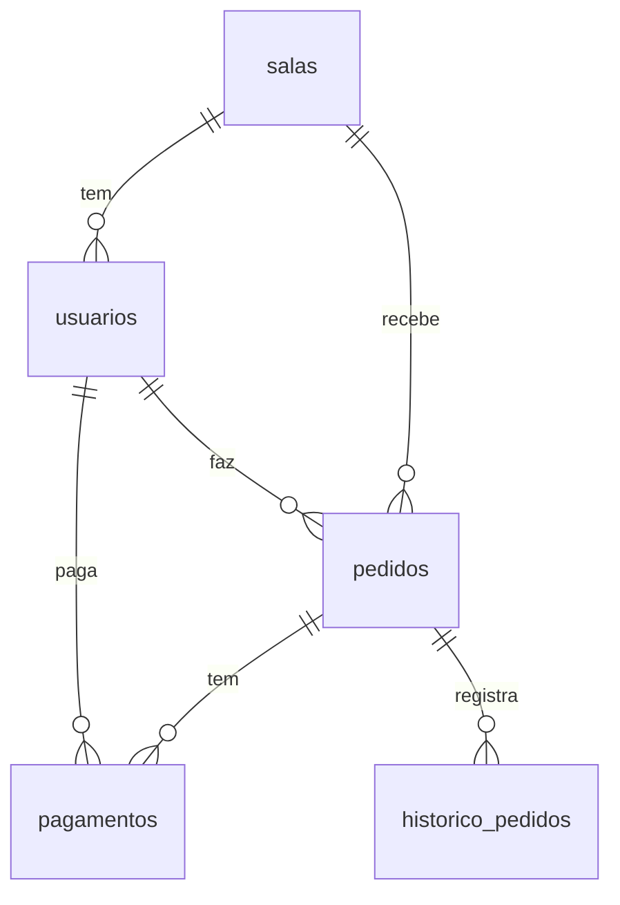

# Banco de dados - Camisas do Intergil (MySQL)

## Passo a passo no VS Code

1. **Tenha um MySQL rodando** no computador (MySQL Community Server 8, ou o MySQL do XAMPP). Anote o usuário e a senha dele.
2. No VS Code, instale a extensão **MySQL** (de cweijan) ou **Database Client**. Ela cria um ícone de banco de dados na barra lateral.
3. Clique em **Create Connection**, preencha host `localhost`, porta `3306`, seu usuário e senha, e conecte.
4. Abra o arquivo `backend/schema.sql`, clique com o botão direito e escolha **Run MySQL Query** (ou use o botão de executar da extensão). Ele cria o banco `intergil`, as tabelas e as 12 salas. Pode rodar de novo sem perder dados.
5. Copie `.env.example` para `.env` e preencha `DB_USER` e `DB_PASSWORD` com os dados do seu MySQL.
6. No terminal do VS Code: `cd backend`, depois `npm install`, depois `npm start`.
7. Para conferir, abra `http://localhost:3000/salas` no navegador. Deve aparecer a lista das 12 turmas.

Para ver os dados, abra o banco `intergil` na barra lateral e clique em cada tabela.

## Como as tabelas se ligam



## O que cada tabela guarda

| Tabela | Uma linha é... | Principais campos |
|---|---|---|
| `salas` | uma turma (já vêm as 12) | cor, nome, preço em centavos, imagem da camisa, chave PIX, contato |
| `usuarios` | um cadastro | nome, número da chamada, sala, papel (aluno, representante, adm), `senha_hash` |
| `pedidos` | uma compra | quem comprou, sala, nome na camisa, tamanho, **preço na hora da compra**, status |
| `pagamentos` | um aviso de pagamento | pedido, valor, chave PIX usada, comprovante, status, quem conferiu e quando |
| `historico_pedidos` | uma mudança de status | pedido, status antes e depois, quem mudou, quando |

## O caminho de uma camisa

1. **Cadastro**: `POST /auth/criar` cria uma linha em `usuarios`. O aluno escolhe a senha, e o banco guarda só o resumo dela (scrypt), nunca a senha em si.
2. **Compra**: `POST /pedidos` cria uma linha em `pedidos` com status `aguardando_pagamento`. O preço vem da sala, não do navegador.
3. **Aviso de pagamento**: o aluno paga o PIX e aperta "Já fiz o pagamento". `POST /pedidos/:id/pagamento` cria uma linha em `pagamentos` com status `informado` (pode mandar a foto do comprovante).
4. **Conferência**: o representante vê `GET /pagamentos?status=informado` e responde com `PATCH /pagamentos/:id`:
   - `confirmado`: o pedido vira `pago`.
   - `recusado`: o pedido continua `aguardando_pagamento` e o aluno pode avisar de novo.
5. **Entrega**: `PATCH /pedidos/:id/status` com `entregue` (só depois de um pagamento confirmado).

Cada mudança de status do pedido também é anotada em `historico_pedidos`.

## Regras que o próprio banco impõe

- Não existe conta repetida (mesmo nome, número, sala e papel).
- Cada pedido tem no máximo 1 pagamento aguardando conferência e 1 confirmado (no MySQL isso é feito com colunas calculadas). Não dá para confirmar duas vezes.
- Tamanho só pode ser P, M, G, GG ou XG, e papel e status só aceitam os valores da lista (ENUM).
- O comprovante fica na pasta `comprovantes/`, que **não é pública**. Só o dono, o representante da sala e o adm conseguem abri-lo, por `GET /pagamentos/:id/comprovante`.

## Consultas úteis

```sql
-- Quanto cada sala já recebeu (pagamentos confirmados)
SELECT s.nome, COUNT(*) AS camisas_pagas, SUM(g.valor_centavos) / 100 AS total_reais
FROM pagamentos g
JOIN pedidos p ON p.id = g.pedido_id
JOIN salas s ON s.id = p.sala_id
WHERE g.status = 'confirmado'
GROUP BY s.id;

-- Quem ainda não pagou
SELECT u.nome, u.numero_chamada, s.nome AS sala, p.nome_camisa, p.tamanho
FROM pedidos p
JOIN usuarios u ON u.id = p.usuario_id
JOIN salas s ON s.id = p.sala_id
WHERE p.status = 'aguardando_pagamento'
ORDER BY s.id, u.nome;

-- Lista para a produção: quantas camisas de cada tamanho por sala
SELECT s.nome, p.tamanho, COUNT(*) AS quantidade
FROM pedidos p JOIN salas s ON s.id = p.sala_id
WHERE p.status IN ('pago', 'entregue')
GROUP BY s.id, p.tamanho;
```

## Cuidados

- Não envie `comprovantes/` nem `.env` para o GitHub (o `.gitignore` já cobre isso). Eles têm dados dos alunos.
- Faça cópia do banco de tempos em tempos: `mysqldump -u SEU_USUARIO -p intergil > backup.sql`.
- A foto do comprovante fica na pasta `comprovantes/` do servidor (no banco fica só o nome do arquivo). Inclua essa pasta nas cópias de segurança.
- Nas salas, o banco usa os números 1 a 12. O site usa 0 a 11. Quando ligarmos os dois, é só somar 1.
